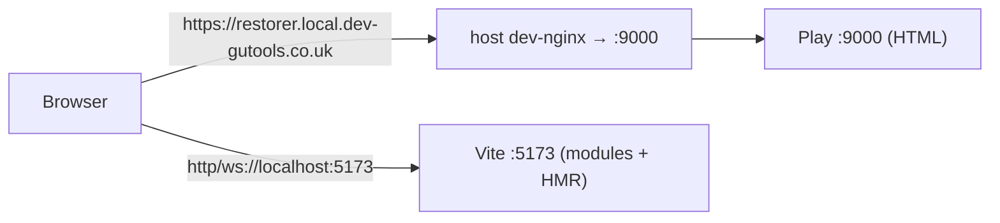
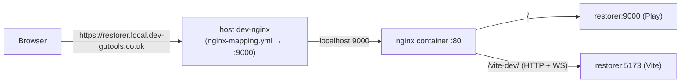

# Restorer

Restores snapshotted content back into Composer. The snapshotting itself is taken care of in [flexible-snapshotter](https://github.com/guardian/flexible-snapshotter).

## Before running locally

### Set up

### Install client-side dependencies and build JS/CSS

Tool versions (Node, Java, sbt, Scala) are pinned in `.tool-versions` and managed
with [mise](https://mise.jdx.dev). Install them once with `mise install`, then:

Run `./scripts/setup`.

```
$ npm install
$ npm run build
```

### Get credentials

- Get [Composer credentials from Janus](https://janus.gutools.co.uk/credentials?permissionId=composer-dev)
- Make sure you have `restore_content` permission on [CODE environment](https://permissions.code.dev-gutools.co.uk/admin)
- Log in to [CODE Workflow](https://workflow.code.dev-gutools.co.uk/dashboard)

## Start the app

The client is built with [Vite](https://vite.dev). You can run the app two ways:

### With a built bundle (no hot reloading)

```
$ npm run build
$ sbt
[restorer] $ run
```

Play serves the bundle from `public/dist` via the Vite manifest. Re-run
`npm run build` (or `npm run build:watch`) after client changes.

### With hot module reloading (standalone)

Run the Vite dev server alongside Play and point Play at it with
`VITE_DEV_SERVER`:

```
# terminal 1 – Vite dev server (serves modules + HMR on :5173)
$ npm run dev

# terminal 2 – Play, told to load the client from the dev server
$ VITE_DEV_SERVER=http://localhost:5173 sbt -Dlocal=true run
```

Play keeps serving the HTML on :9000 and injects the Vite client, so JS/CSS
changes hot-reload without a page refresh.



- Host port 9000 is Play itself.
- `VITE_DEV_SERVER=http://localhost:5173` with `VITE_PROXIED` unset, so the
  browser loads modules and opens the HMR websocket directly against
  `localhost:5173`. nginx is not involved, and the `websocket: /vite-dev/` entry
  in `nginx/nginx-mapping.yml` is unused.
- Port 5173 must be reachable from the host browser (forward it if running in
  the devcontainer).

The app will then be accessible locally at: <https://restorer.local.dev-gutools.co.uk/>


## Run end-to-end tests headlessly

Use:

```
npm run test

```

Testing interactively

run `npm run test:ui` in your `devcontainer` terminal
Open a browser on your host machine and point it at localhost:9323 to open the Playwright UI

Playwright discovers and runs the specs under `e2e-tests/steps`.

### E2E reports

CI prints list output and adds GitHub failure annotations. Playwright and Cucumber
HTML reports are uploaded together as the `e2e-report` artifact, retained for 14 days
after successful or failed runs, excluding cancelled runs. Traces and videos are
captured on the first retry, and screenshots only on failure. Failures before
report generation may leave no reports to upload.

## Run local stack only - no AWS credentials and all services mocked locally

If you want the same Testcontainers stack used by the e2e test without running the
spec itself, use:

```
npm run dev:local
```

This starts LocalStack and Restorer using the same bootstrap code as the e2e suite and
keeps the stack running until you press Ctrl+C.

HMR works through the same origin, routed via nginx:



- Host port 9000 is the nginx container's port 80, not Play.
- `entrypoint.dev.sh` sets `VITE_DEV_SERVER=/vite-dev` (same-origin module path)
  and `VITE_PROXIED=true` (HMR connects over `wss://…:443/vite-dev/`).
- The nginx container routes `/vite-dev/` to `restorer:5173` with websocket
  upgrade headers (`e2e-tests/images/nginx-dev.conf.template`).
- The `websocket: /vite-dev/` entry in `nginx/nginx-mapping.yml` makes the host
  dev-nginx pass the websocket upgrade through to :9000; without it HMR fails
  before reaching the container.


